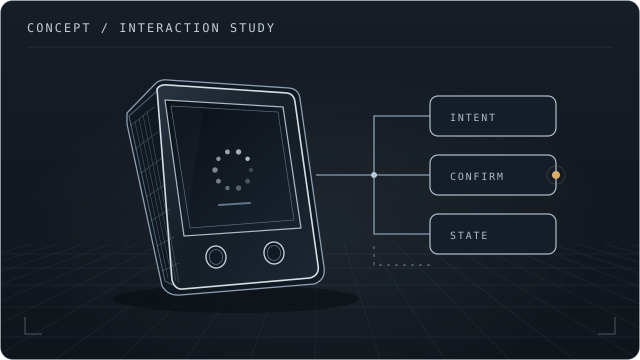
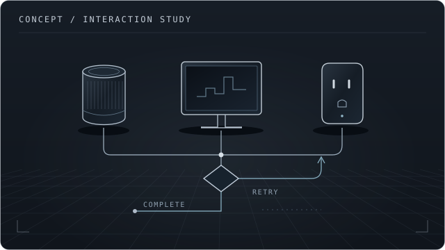
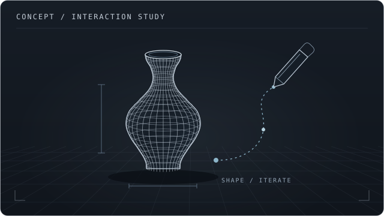

<!-- Profile refresh: bilingual, project-first. Keep the blog markers for the existing feed workflow. -->

<a href="https://yulili-ai.github.io/">
  <picture>
    <source media="(prefers-reduced-motion: reduce)" srcset="./assets/hero-capabilities-poster.png?v=3">
    
  </picture>
</a>

# AI Product Manager & Builder

从真实场景出发，探索 Agent、交互与实体设备如何协作。

AI Native / Human–AI Interaction / AI Hardware

[Portfolio ↗](https://yulili-ai.github.io/) &nbsp; · &nbsp; [Selected Builds ↓](#selected-builds) &nbsp; · &nbsp; [Writing ↓](#writing)

 

## Selected Builds

开发与交互实验。配图为交互示意，具体实现与边界见项目说明。

<table>
  <tr>
    <td width="300"></td>
    <td width="580">
      <h3>Bedside Agent</h3>
      
床边 AI 助手 意图理解、实体确认与执行反馈。

      
LOCAL MVP · 台灯模拟

      <a href="./projects/bedside-agent.md">Project notes ↗</a>
    </td>
  </tr>
  <tr>
    <td></td>
    <td width="580">
      <h3>ZlinkOS</h3>
      
智能生活 Agent 多设备任务编排与异常恢复的交互探索。

      
INTERACTION PROTOTYPE · MOCK

      <a href="./projects/zlinkos.md">Project notes ↗</a>
    </td>
  </tr>
  <tr>
    <td></td>
    <td width="580">
      <h3>Chengyi</h3>
      
非遗 AI 共创体验 探索对话、空间交互与创作过程的结合。

      
INTERACTIVE PROTOTYPE · 在线版使用本地规则

      <a href="./projects/chengyi.md">Project notes ↗</a> &nbsp; · &nbsp;
      <a href="https://yulili-ai.github.io/chengyi-3/">Try demo ↗</a> &nbsp; · &nbsp;
      <a href="https://github.com/yulili-ai/chengyi-3">Code ↗</a>
    </td>
  </tr>
</table>

 

## On the Workbench

正在探索的问题：

- **Human in the loop** — AI 何时行动，何时需要人确认？
- **When things go wrong** — 设备断连、模型失败后，体验如何继续？

 

## Writing

写下构建过程里的尝试、取舍与复盘。公众号：**YULi.AI产品与体验**。

<!-- BLOG-POST-LIST:START -->
在微信搜索「YULi.AI产品与体验」，阅读 AI 产品、Agent 交互与开发探索。
<!-- BLOG-POST-LIST:END -->

---

Curious by nature. Building to learn.

[Portfolio ↗](https://yulili-ai.github.io/) &nbsp; · &nbsp; [More repositories ↗](https://github.com/yulili-ai?tab=repositories) &nbsp; · &nbsp; [小红书 ↗](https://xhslink.cn/o/qqrzqPKUyk)
