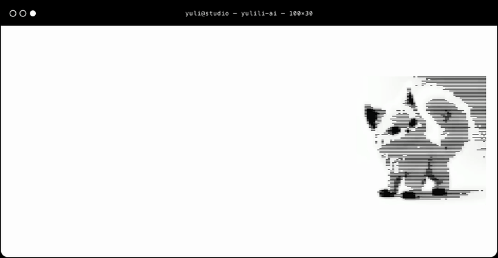
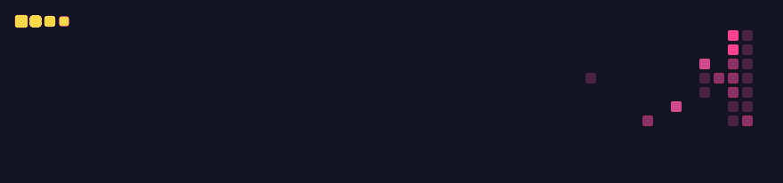

<!--
YULi 的 GitHub 个人主页（yulili-ai/yulili-ai 仓库的 README.md）。HTML 注释不会显示在主页上。

主题 theme=radical（深色炫彩，全页统一）
  bg #141321 · title / ring #fe428e · text #a9fef7 · icon / snake #f8d847
  stats:      theme=radical&show_icons=true&hide_border=true&border_radius=12&hide=contribs
  top-langs:  theme=radical&layout=compact&hide_border=true&border_radius=12&langs_count=6&card_width=420
  streak:     theme=radical&hide_border=true&border_radius=12
  trophy:     theme=radical&column=5&margin-w=8&margin-h=8&rank=-%3F
  snake:      color_snake=#f8d847&color_dots=#141321,#4a2344,#8d3268,#d24a90,#fe428e&color_background=#141321

官方 https://github-readme-stats.vercel.app 目前返回 503 DEPLOYMENT_PAUSED，
https://github-profile-trophy.vercel.app 目前返回 402 DEPLOYMENT_DISABLED。
卡片改用同一项目仍在线的公共节点，避免主页裂图：
  https://github-readme-stats.shion.dev （anuraghazra/github-readme-stats）
  https://trophy.ryglcloud.net （ryo-ma README 列出的负载均衡节点）
streak 使用维护中的 https://streak-stats.demolab.com （DenverCoder1）。
打字动效 https://readme-typing-svg.demolab.com 。
小蛇由 .github/workflows/profile.yml 的 Platane/snk 生成：
  主页使用 assets/github-contribution-grid-snake.gif（工作流会提交更新）
  同一次运行另把 SVG / GIF 推到 output 分支（github-snake.svg、github-snake-dark.svg、github-contribution-grid-snake.gif）
-->

  

<h1 align="center">你好，我是李雨 YULi 👋</h1>

  

  

  

点击上方终端，进入我的个人网站

我是一名 AI 产品经理。 
3 年 AI 产品经验，10 年互联网产品与用户体验经验。 
做过真实落地的 AI Agent，也帮企业做 AI+ 产品化转型。 
我用 AI coding 把想法直接做成能用的产品。 
4A 品牌出身，比起技术能做到什么，我更关心用户会不会用、业务能不能赚钱。

🌐 <a href="https://yulili-ai.github.io/">个人网站</a> · 📕 <a href="https://xhslink.cn/o/qqrzqPKUyk">小红书</a> · 💬 公众号「YULi.AI产品与体验」

---

## 📊 数据看板

  
  

  

  

---

## ⭐ 精选项目

从商业价值出发。  
用 AI 把它做出来。

🏺 [**承艺 · 非遗 AI 共创原型**](https://github.com/yulili-ai/chengyi-prototype)  
桌面单屏交互原型，用对话体验瓷器与剪纸创作。  
包含三维工序展示、拖动塑形与撤销重做。  
也对比了「空间旁白」与「具象 IP」两种陪伴方式。

🏠 [**智爱家品牌网站**](https://yulili-ai.github.io/zi-home-brand-site/)  
个人概念作品，无构建的单页品牌站。  
原生 HTML / CSS / JS，配合 GSAP 与 Lenis 做滚动动效。

📸 [**overseas-web-screenshot**](https://github.com/yulili-ai/overseas-web-screenshot)  
Kimi 插件，一句话给海外网站截图。  
自动探测本机代理，无头 Chrome 出图。  
支持整页长截图与批量网址。

🧩 [**aipm-course-notes**](https://github.com/yulili-ai/aipm-course-notes)  
把 AI 产品经理课程素材整理成结构化笔记的 Skill。  
输出知识表格、PM 思考、延展问题与面试金句。

📒 [**Today I Learned**](https://github.com/yulili-ai/Today-I-Learned-Daily-notes)  
每日学习笔记，一条命令新建当天记录。

---

## 🧭 方法

从品牌与体验到 AI 产品，我用一套「价值 → 体验 → 智能」三层框架推进：

1. **价值层**：这件事值不值得做，靠什么赚钱
2. **体验层**：用户在什么时候需要 AI，Agent 怎么跟人配合
3. **智能层**：用 AI coding 和 Agent 工作流快速做出来、验证、迭代

---

## ✍️ 写作

我在公众号「YULi.AI产品与体验」写这些：AI 商业化与行业观察、AI 产品方法论、工具与工作流、AI 创作与审美。

<!-- 下面两行标记之间的内容会被 GitHub Actions 自动替换成最新文章，标记本身不要删 -->
<!-- BLOG-POST-LIST:START -->
• 在微信搜索「YULi.AI产品与体验」，阅读我最近的文章
<!-- BLOG-POST-LIST:END -->

---

## 关于

- AI 产品经理：3 年 AI 产品经验，做过真实落地的 AI Agent 项目
- 10 年互联网产品与用户体验经验，覆盖生活服务、K12 教育、智能硬件
- 有创业经历，帮企业做 AI+ 产品化转型
- 奥美 4A 出身：品牌策略、商业化、创意与线上活动运营

---

## 🐍 贡献小蛇

  

GitHub 贡献图 · 小蛇动画

  

