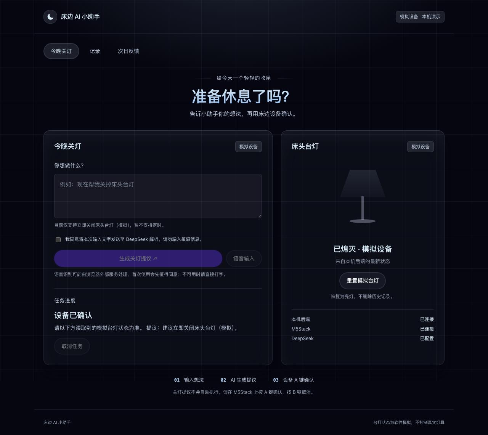
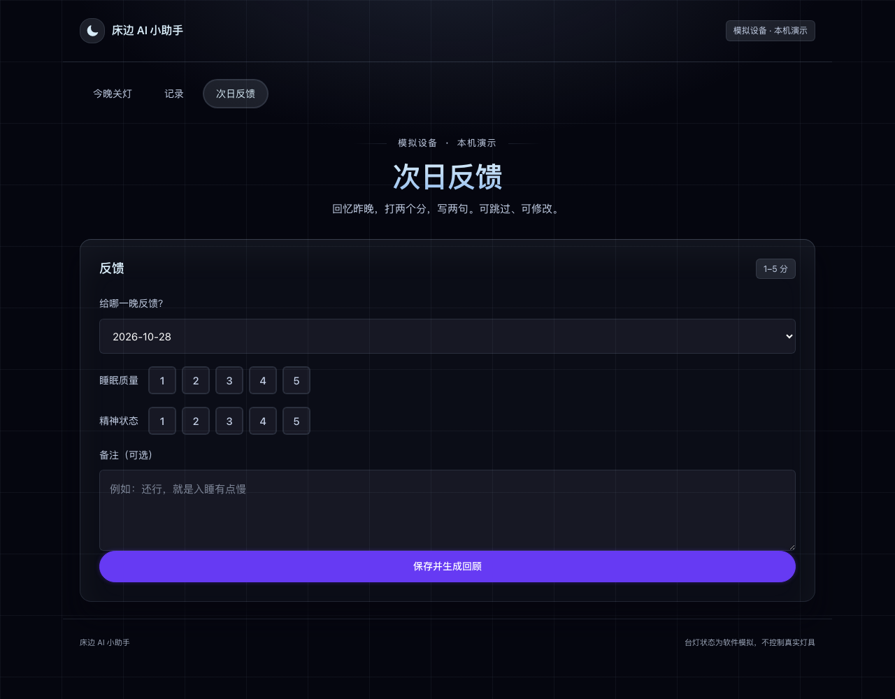
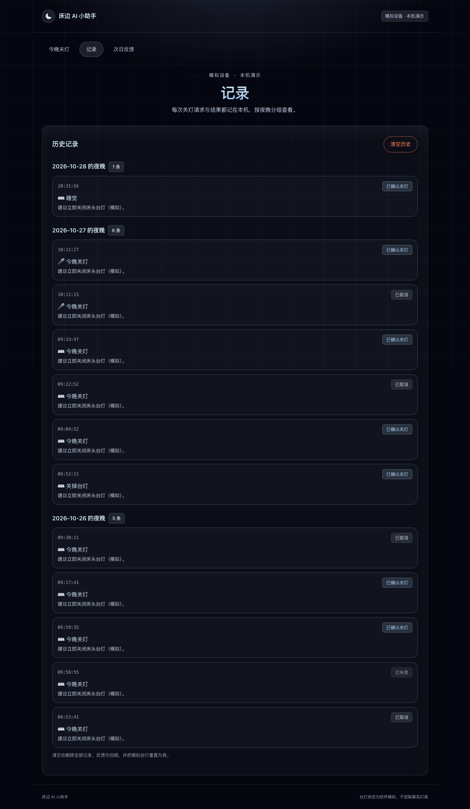
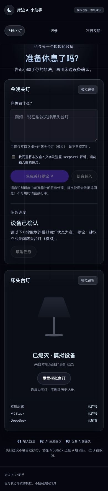

# Bedside Agent · 床边 AI 助手

**Local MVP · 实体确认 · 台灯模拟**

[在线 Demo ↗](https://yulili-ai.github.io/bedside-agent/) · [源码与下载 ↗](https://github.com/yulili-ai/bedside-agent) · [Star 收藏 ↗](https://github.com/yulili-ai/bedside-agent)

在线版用浏览器规则和模拟 A / B 按钮展示完整交互，不调用模型或连接硬件。真实 DeepSeek 与 M5Stack 流程可克隆源码后在本机运行。

## 场景

从睡前一句「今晚关灯」出发，探索 AI 如何把意图变成清楚、可确认、可回看的行动。第一版聚焦「现在关闭床头灯」，没有扩展为完整智能家居系统。

## 交互思路

文字或语音输入 → AI 提议 → M5Stack 实体按键确认／取消 → 模拟台灯状态变化 → 记录 → 次日反馈与 AI 回顾。模型负责理解和归纳；执行由规则和实体确认约束。超时、断连或重启后，旧提议应失效。

## 界面预览

以下为 2026-10-28 本机阶段验收截图；台灯为软件模拟。

### 今晚关灯

输入文字或语音后生成提议，经 M5Stack 实体按键确认再更新模拟台灯状态。下图展示确认后的界面。

### 次日反馈

填写睡眠质量、精神状态与备注后，可保存并生成 AI 回顾。下图展示反馈填写入口。

查看操作记录页面

按夜晚查看演示中的关灯确认、取消等记录。

查看移动宽度布局

390px 窄屏布局预览；此图不代表手机访问或语音已完成实测。

## 当前边界

本机单用户 MVP 已有真实模型、M5Stack 按键及前端联调记录；本次发布未重新调用真实模型或验证实体硬件。真实硬件仅 M5Stack，台灯与插座均为模拟；语音依赖浏览器能力，不可用时退回文字。本机版断连后任务立即作废、模型有限重试仍有待补项。

2026-11-12 新增独立公开仓库与 GitHub Pages 交互演示。在线版的意图处理与回顾均为明确标注的规则模拟，数据只保存在当前浏览器，不提供共享后台或账号服务。登录 GitHub 后可在仓库右上角点 Star 收藏，也可通过 Code 下载或克隆完整本机源码。

## 下一步

补充设备与界面同框的演示，重新核对异常流程，再评估接入真实灯具。重点观察确认成本、失败反馈，以及用户是否理解 AI 的执行边界。

[← Back to profile](../README.md)
